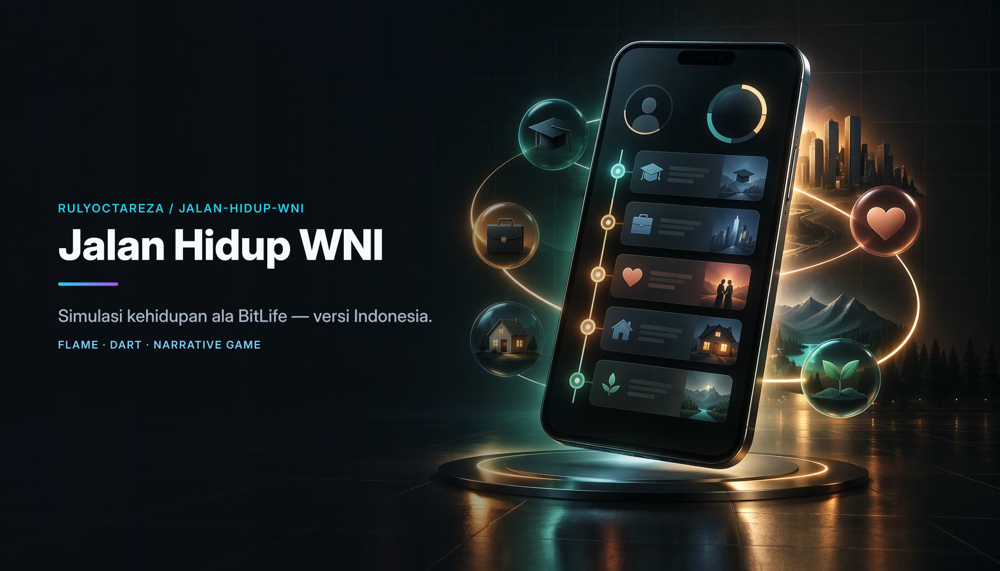

<p align="center">
  
</p>

<h1 align="center">Jalan Hidup WNI</h1>

<p align="center">
  <b>Simulasi kehidupan ala BitLife — versi Indonesia.</b><br>
  Lahir, besar, jatuh, bangkit — melewati presiden, krisis, dan sejarah nyata.
</p>

<p align="center">
  <a href="https://flutter.dev"></a>
  <a href="https://riverpod.dev"></a>
  
  
</p>

---

## ✨ Preview

<p align="center">
  
</p>

> **Catatan:** gambar di atas adalah *ilustrasi konsep*, bukan screenshot asli. Tampilan in-game
> akan ditambahkan setelah build berikutnya.

---

## 📖 Tentang

Satu nyawa, satu cerita. Kamu hidup dari lahir sampai mati sebagai WNI, melewati fase
**menderita → sukses → jatuh → bangkit**, sambil dihadapkan pada peristiwa sejarah nyata:
pergantian presiden, krisis moneter, pandemi, dan titik-titik kritis yang mengubah arah hidup.

Semua konten dibuat *content-driven* lewat JSON, jadi cerita bisa ditambah tanpa menyentuh
logika game.

---

## 🌟 Fitur

| Fitur | Deskripsi |
|---|---|
| 🧬 **Life Simulator** | Siklus hidup penuh: lahir, sekolah, kerja, menikah, pensiun, mati. |
| 🏛️ **Sejarah Indonesia** | Presiden 1945–2034, era Orde Lama → Era Baru, dan event nasional (Krismon, COVID, tsunami). |
| 🎭 **10 Fase Emosional** | Hidup naik-turun: menderita, sukses, jatuh, lalu bangkit. |
| 🔀 **Titik Kritis Permanen** | Keputusan penting yang mengubah jalan cerita secara permanen. |
| 👶 **Birth Cohort 1960–2015** | Kondisi awal berbeda tergantung generasi kelahiran. |
| 🎨 **Flat Modern UI** | Antarmuka bersih, ringan, dan fokus ke cerita. |

---

## 🛠️ Tech Stack

- **Flutter** (Android + iOS)
- **Riverpod** + **GoRouter** untuk state dan navigasi
- **SharedPreferences** untuk progres lokal
- **audioplayers** dan `url_launcher` untuk audio serta tautan eksternal

---

## 🚀 Menjalankan

```bash
flutter pub get
flutter run
```

---

## 📚 Dokumentasi Desain

| Dokumen | Isi |
|---|---|
| [NARRATIVE_FRAMEWORK.md](docs/NARRATIVE_FRAMEWORK.md) | Jalan cerita, fase hidup, titik kritis, arc 6 act |
| [GDD_MASTER.md](docs/GDD_MASTER.md) | Game design document lengkap |
| [AUDIO_DESIGN.md](docs/AUDIO_DESIGN.md) | Arah desain audio |
| [ASSET_MANIFEST.md](docs/ASSET_MANIFEST.md) | Daftar aset dan statusnya |

---

## 📦 Content Assets

```text
assets/content/
├── history/
│   ├── presidents.json         # Presiden 1945–2034
│   ├── eras.json               # Orde Lama → Era Baru
│   └── national_events.json    # Krismon, COVID, tsunami, dll.
└── game/
    ├── life_phases.json        # 10 fase emosional
    ├── critical_junctions.json # Titik kritis permanen
    └── birth_cohorts.json      # Generasi 1960–2015
```

Engine-nya ada di `lib/game_engine/`: `life_simulator.dart`, `phase_resolver.dart`,
`event_pool.dart`, `activity_engine.dart`, dan `history_context.dart`.

---

<p align="center">Dibuat untuk semua WNI yang pernah ingin mengulang hidupnya sekali lagi 🇮🇩</p>
